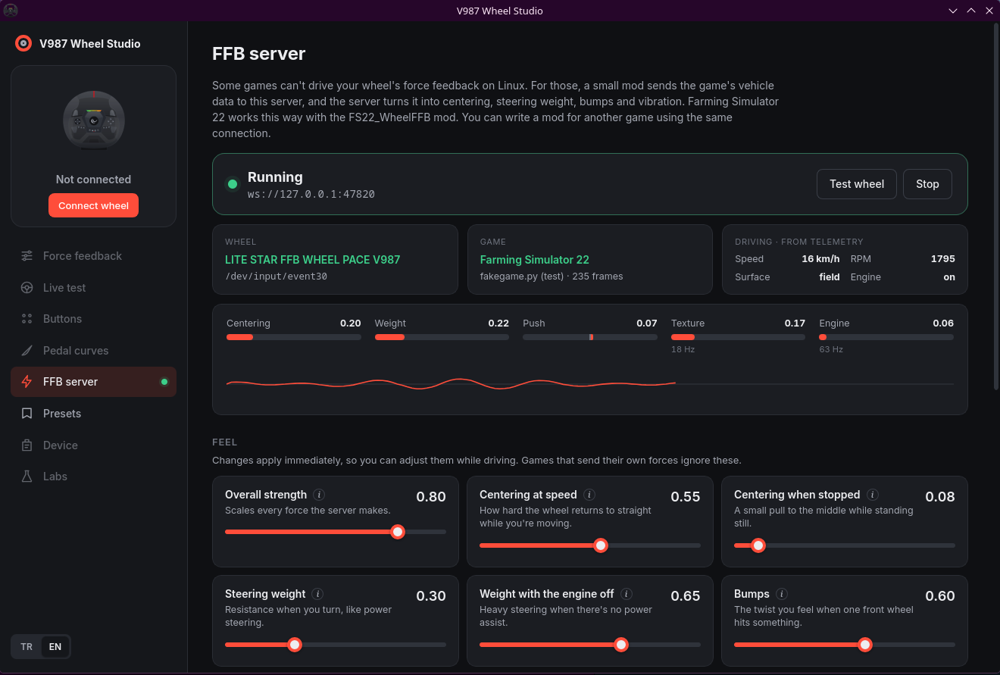
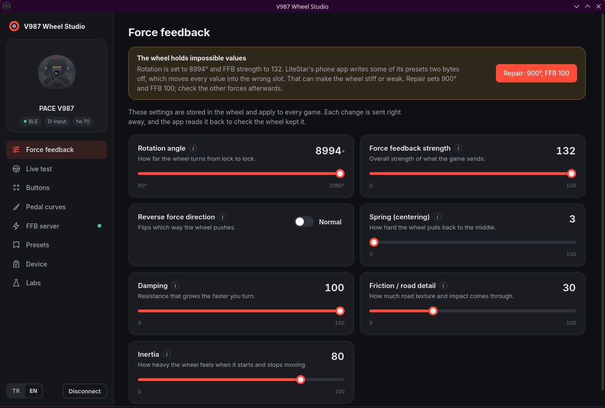
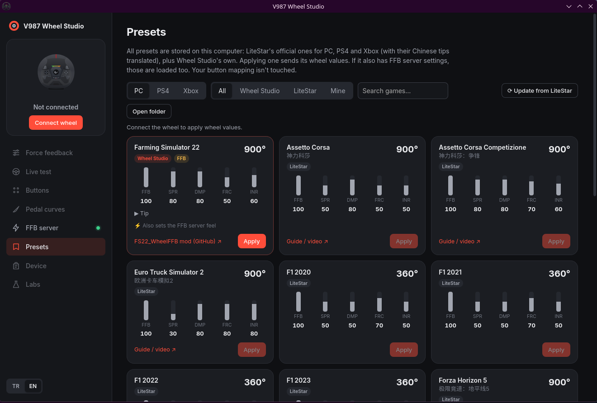

# V987 Wheel Studio

[Türkçe](README.tr.md)

A desktop app for the LiteStar FFB wheel sold as the **Rampage Pace V987**, for Linux and Windows.
It does what the vendor's phone app does, shows settings the phone app hides, and adds a force
feedback server for games that can't drive the wheel on Linux.



## What it does

**Wheel settings over Bluetooth.** Rotation angle, force feedback strength, spring, damping,
friction, inertia and force direction. Every change is sent right away and read back from the
wheel, and a small label next to each setting tells you whether the wheel saved it. The help text
for each setting explains what it does, with example values for trucks, cars, rally and tractors.
The meanings come from the vendor's Chinese descriptions.

**Buttons, pedals, live test.** Remap any button to another button, a keyboard key or a mouse
click. Draw response curves for the throttle, brake and clutch. Watch every button, the wheel
angle, the pedals and the gear light up live.

**Presets, stored locally.** All of LiteStar's official presets for PC, PS4 and Xbox are included
and correctly decoded. The Chinese tips are translated to English and Turkish. Wheel Studio adds
its own presets on top, starting with Farming Simulator 22. Presets are plain TOML files you can
edit or share; the format is in [docs/PRESETS.md](docs/PRESETS.md).

**FFB server.** Some games can't use your wheel's force feedback on Linux. For those, a small mod
sends the game's vehicle data to Wheel Studio over a local WebSocket, and the app turns it into
centering, steering weight, bumps and vibration. The FFB server page shows the connected game, the
forces as they happen, and sliders that change the feel while you drive. Farming Simulator 22 works
through [FS22_WheelFFB](https://github.com/egeSlop/FS22_WheelFFB). The server is its own project,
[ffb-server](https://github.com/egeSlop/ffb-server), and its protocol is documented so anyone can
write a mod for another game.

**Labs.** Features that exist in the vendor's firmware kit but aren't shown for this wheel. Each one
can be checked with a single harmless request.

| | |
|---|---|
|  |  |

## Install

### Linux

Download the AppImage or the `.rpm` from [Releases](https://github.com/egeSlop/v987-wheel-studio/releases),
or build it yourself (below). Bluetooth must be on. Close the vendor's phone app first, because the
wheel only accepts one Bluetooth connection.

The FFB server needs write access to the wheel's `/dev/input/event*` node. Desktop distributions
usually grant it to the logged-in user.

For a headless FFB server, used by game launch scripts, run `v987-wheel-studio --ffb-server`.

### Windows (untested)

There is a Windows build in Releases, marked untested. It compiles, and the Bluetooth part uses the
same library as on Linux, but nobody has run it on a real wheel yet. The FFB server uses
DirectInput on Windows. If you try it, please open an issue with what worked and what didn't.

## Build from source

```sh
git clone --recursive https://github.com/egeSlop/v987-wheel-studio
cd v987-wheel-studio
npm install
npm run tauri build
```

You need Rust, Node.js 20 or newer, and Tauri's Linux dependencies (WebKitGTK 4.1, libappindicator,
librsvg, plus `dbus-devel` for Bluetooth). `crates/ffb-server` is a git submodule, so clone with
`--recursive` or run `git submodule update --init` afterwards.

For a Windows build from Linux, install the `x86_64-pc-windows-gnu` Rust target and mingw-w64, then run
`npm run build && cd src-tauri && cargo build --release --target x86_64-pc-windows-gnu`.
The result is a portable `.exe`; it uses the WebView2 runtime that ships with Windows 10 and 11.

## How it talks to the wheel

The V987 is a LiteStar "FFB WHEEL" with a Bluetooth LE configuration channel next to its USB
game controller. The protocol was worked out from the vendor's Android app and checked against the
real wheel; it's written up in [docs/PROTOCOL.md](docs/PROTOCOL.md). On USB the wheel is an
ordinary HID PID force feedback device. On Linux it needs the
[universal-pidff](https://github.com/JacKeTUs/universal-pidff) driver with the V987's ID (`11ff:2370`)
added.

## About

This is an unofficial project with no connection to LiteStar, PXN or Rampage. Use it at your own
risk: it writes to the wheel's settings memory, although every write is one the vendor app can also
make, and Device > Factory reset undoes everything.

The app was vibecoded: Claude (Anthropic) wrote most of the code in conversation with me, and I
tested it on my own wheel. Expect rough edges and please report them.

## License

MIT
