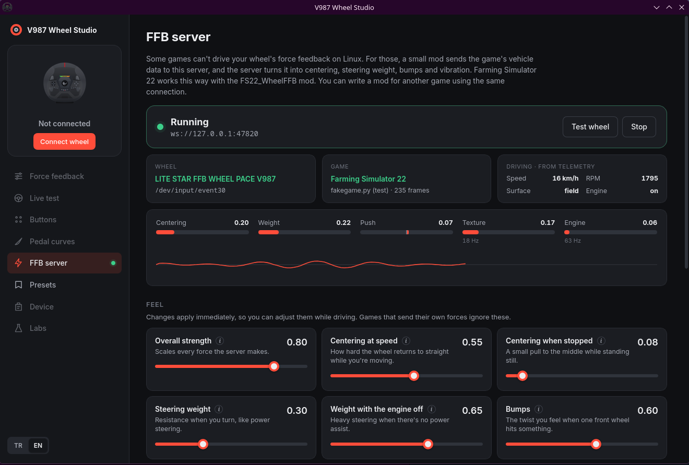
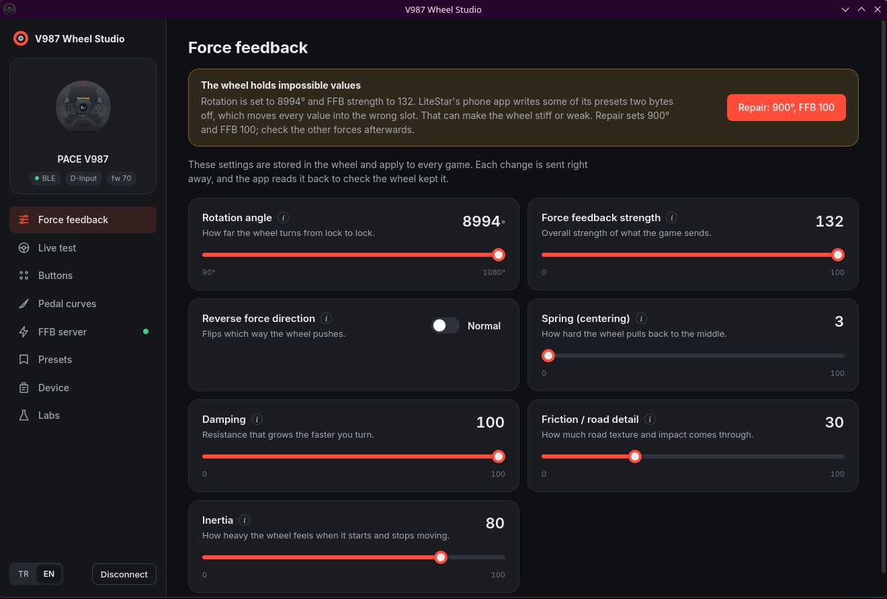
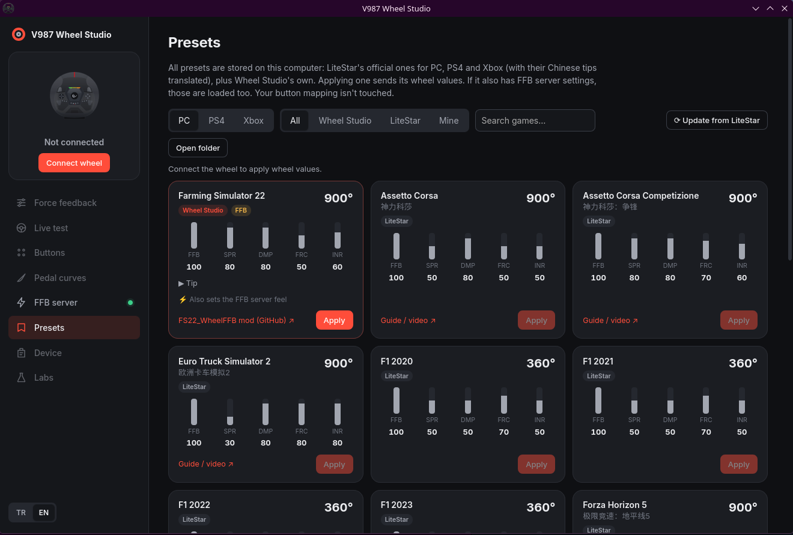

# V987 Wheel Studio

[English](README.md)

**Rampage Pace V987** adıyla satılan LiteStar FFB direksiyon için Linux ve Windows masaüstü
uygulaması. Üreticinin telefon uygulamasının yaptığı her şeyi yapar, onun gizlediği ayarları
gösterir ve Linux'ta direksiyonu kendisi süremeyen oyunlar için bir FFB sunucusu ekler.



## Neler yapıyor

**Bluetooth üzerinden direksiyon ayarları.** Dönüş açısı, FFB gücü, yay, sönümleme, sürtünme,
atalet ve kuvvet yönü. Her değişiklik hemen gönderilir ve direksiyondan geri okunur. Her ayarın
yanındaki küçük etiket direksiyonun ayarı kaydedip kaydetmediğini gösterir. Her ayarın açıklaması
ne işe yaradığını anlatır ve tır, otomobil, ralli ve traktör için örnek değerler verir. Anlamlar
üreticinin Çince açıklamalarından çıkarıldı.

**Tuşlar, pedallar, canlı test.** Herhangi bir tuşa başka bir tuş, klavye tuşu ya da fare tıklaması
atayın. Gaz, fren ve debriyaj için tepki eğrisi çizin. Tuşları, direksiyon açısını, pedalları ve
vitesi canlı izleyin.

**Profiller bilgisayarınızda.** LiteStar'ın PC, PS4 ve Xbox için bütün resmi profilleri doğru
çözümlenmiş halde uygulamanın içinde. Çince ipuçları Türkçeye ve İngilizceye çevrildi. Wheel Studio
bunlara kendi profillerini ekliyor, ilki Farming Simulator 22. Profiller düzenleyip
paylaşabileceğiniz düz TOML dosyaları; biçimi [docs/PRESETS.md](docs/PRESETS.md) dosyasında.

**FFB sunucusu.** Bazı oyunlar Linux'ta direksiyonun FFB'sini kullanamıyor. Bu oyunlarda küçük bir
mod aracın verilerini yerel bir WebSocket üzerinden Wheel Studio'ya gönderir, uygulama da bunları
merkezlemeye, direksiyon ağırlığına, tümseklere ve titreşime çevirir. FFB sunucusu sayfası bağlı
oyunu, o anki kuvvetleri ve sürerken hissi değiştiren kaydırıcıları gösterir. Farming Simulator 22
[FS22_WheelFFB](https://github.com/egeSlop/FS22_WheelFFB) moduyla çalışıyor. Sunucu ayrı bir proje,
[ffb-server](https://github.com/egeSlop/ffb-server). Protokolü belgelendi, yani herkes başka bir oyun
için mod yazabilir.

**Tablet paneli.** Wheel Studio'nun gösterdiği adresi aynı Wi-Fi'daki bir tablette ya da telefonda
açın (ya da QR kodu okutun). Karşınıza oyundan hız, vites, devir, yakıt ve sinyal lambalarını
gösteren bir oto teyp ekranı çıkar. Altında da PC'de oyunun tuşlarına basan butonlar var: farlar,
tepe lambası, sinyaller, korna, hız sabitleyici, ekipmanlar, kameralar. Radyo ya oyunun kendi
radyosunu kullanır ya da tabletten internet radyosu çalar (FS22'ye eklediğiniz istasyonlar da
listede). Sayfa sessiz bir videoyla ekranı açık tutar, tam ekran tuşu da var. Farming Simulator 22,
Euro Truck Simulator 2, American Truck Simulator, Assetto Corsa ve DiRT Rally 2.0 için profil hazır.
Başka bir oyun da bir modla veri gönderip kendi profilini alabilir, nasıl yapılacağı
[docs/DASH.md](docs/DASH.md) dosyasında. Şimdilik oyunun içinde sadece FS22 denendi.

**Deneysel.** Üreticinin yazılım altyapısında olan ama bu direksiyon için gösterilmeyen özellikler.
Her biri zararsız tek bir istekle denenebilir.

| | |
|---|---|
|  |  |

## Kurulum

### Linux

[Releases](https://github.com/egeSlop/v987-wheel-studio/releases) sayfasından AppImage ya da `.rpm`
dosyasını indirin, ya da aşağıdaki gibi kendiniz derleyin. Bluetooth açık olmalı. Üreticinin telefon
uygulamasını önce kapatın, çünkü direksiyon aynı anda tek Bluetooth bağlantısı kabul ediyor.

FFB sunucusunun direksiyonun `/dev/input/event*` dosyasına yazabilmesi gerekir. Masaüstü dağıtımları
bu izni genelde oturum açmış kullanıcıya verir.

Oyun başlatma betikleri için penceresiz bir FFB sunucusu: `v987-wheel-studio --ffb-server`.

### Windows (denenmedi)

Releases sayfasında "denenmedi" diye işaretli bir Windows sürümü var. Derleniyor ve Bluetooth tarafı
Linux'takiyle aynı kütüphaneyi kullanıyor, ama henüz kimse gerçek bir direksiyonda çalıştırmadı. FFB
sunucusu Windows'ta DirectInput kullanıyor. Denerseniz neyin çalışıp neyin çalışmadığını bir issue
açarak yazarsanız çok işe yarar.

## Kaynaktan derleme

```sh
git clone --recursive https://github.com/egeSlop/v987-wheel-studio
cd v987-wheel-studio
npm install
npm run tauri build
```

Rust, Node.js 20 ya da üstü ve Tauri'nin Linux bağımlılıkları (WebKitGTK 4.1, libappindicator,
librsvg, Bluetooth için de `dbus-devel`) gerekir. `crates/ffb-server` bir git alt modülü; bu yüzden
`--recursive` ile klonlayın ya da sonradan `git submodule update --init` çalıştırın.

Linux'tan Windows sürümü derlemek için `x86_64-pc-windows-gnu` Rust hedefini ve mingw-w64'ü kurup
`npm run build && cd src-tauri && cargo build --release --target x86_64-pc-windows-gnu` çalıştırın.
Çıkan dosya kurulum gerektirmeyen bir `.exe`; Windows 10 ve 11 ile gelen WebView2'yi kullanır.

## Direksiyonla nasıl konuşuyor

V987, USB oyun kumandasının yanında bir Bluetooth LE ayar kanalı olan bir LiteStar "FFB WHEEL".
Protokol üreticinin Android uygulamasından çıkarıldı ve gerçek direksiyonda denendi; ayrıntılar
[docs/PROTOCOL.md](docs/PROTOCOL.md) dosyasında. USB tarafında direksiyon sıradan bir HID PID FFB
cihazı. Linux'ta, V987'nin kimliği (`11ff:2370`) eklenmiş
[universal-pidff](https://github.com/JacKeTUs/universal-pidff) sürücüsüne ihtiyaç duyar.

## Hakkında

Resmi olmayan bir proje; LiteStar, PXN ya da Rampage ile bir bağı yok. Kullanım riski size ait:
uygulama direksiyonun ayar hafızasına yazar. Yine de yazdığı her şeyi üreticinin uygulaması da
yazabiliyor ve Cihaz > Fabrika ayarları her şeyi geri alır.

Uygulama vibecode'landı: kodun çoğunu Claude (Anthropic) benimle konuşarak yazdı, ben de kendi
direksiyonumda denedim. Pürüzler çıkabilir, lütfen bildirin.

## Lisans

MIT
